<p align="center">
  
</p>

<p align="center">
  
</p>

<p align="center">
  
  
  
  
</p>

## Overview

An earlier version of my personal portfolio, built with React, TypeScript, Tailwind CSS and Framer Motion. It presents selected projects, my CV and contact details with animated transitions and a custom project gallery.

## Highlights

- Animated hero and section transitions with Framer Motion
- Project showcase with captured screenshots
- Downloadable CV
- Responsive Tailwind layout
- Lucide icon set

## Tech stack

<p align="center">
  
</p>

## Getting started

**Prerequisites:** Node.js 20+.

```bash
npm install
npm run dev
```

---

<p align="center">
  
</p>

<p align="center">
  Built by <a href="https://github.com/Skander-Bardaoui"><b>Skander Bardaoui</b></a> ·
  <a href="https://skander-bardaoui.netlify.app/">Portfolio</a> ·
  <a href="https://github.com/Skander-Bardaoui?tab=repositories">All repositories</a>
</p>
